<div align="center">

# Victron MultiPlus-II Card

A Home Assistant card that looks like the front of a Victron MultiPlus-II. It has the same eight LEDs, they blink the same way, and a few lines under the panel tell you what the inverter is doing.

[](https://github.com/valimaties/victron-multiplus-II-card/releases)
[](https://hacs.xyz/docs/faq/custom_repositories)
[](https://www.home-assistant.io/)
[](LICENSE)
[](#-languages)

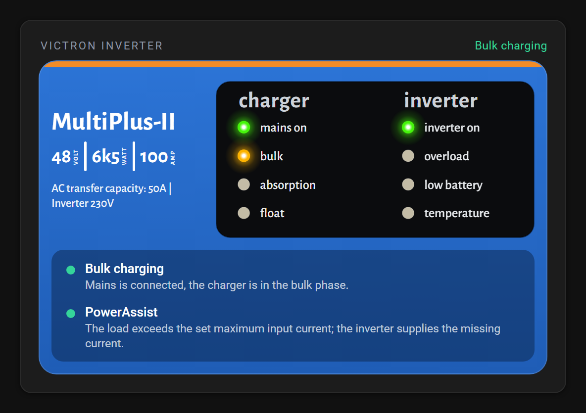

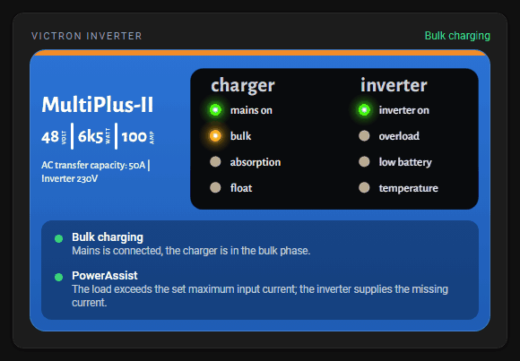

</div>

---

## ✨ What it does

- 🎛️ Draws the front of the unit: the blue panel, the orange band, the black window with the printed text.
- 💡 The eight LEDs can be off, on, blinking, or blinking in the opposite phase, with a glow like the real ones. All the blinking LEDs stay in step.
- 🧠 Under the panel it says in words what the LEDs mean: bulk charging, PowerAssist, an overload warning and so on, as described in the MultiPlus-II manual.
- 🛑 It shows the alarms that the Victron MQTT integration reports: overload, low battery, ripple, grid lost and so on.
- 🌍 English and Romanian, taken from your Home Assistant language.
- ⚙️ You give it the type code of your unit (`48/6k5/100-50`, `12/3000/120-32`...) and it prints the right volt, watt and amp on the panel.
- 🪟 There is also a small version that shows only the black LED window (see below).
- 🖥️ It has an editor in the UI that can find the sensors by name. It follows the light and dark theme, and it is one file with no dependencies.

## 📸 What it looks like

<div align="center">

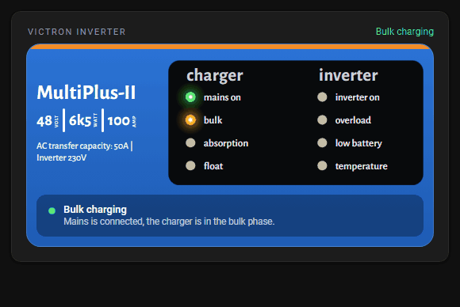

*Bulk, absorption, float, running on the battery, PowerAssist, overload and low battery warning, temperature alarm, VE.Bus error, standby.*

</div>

<table>
<tr>
<td align="center">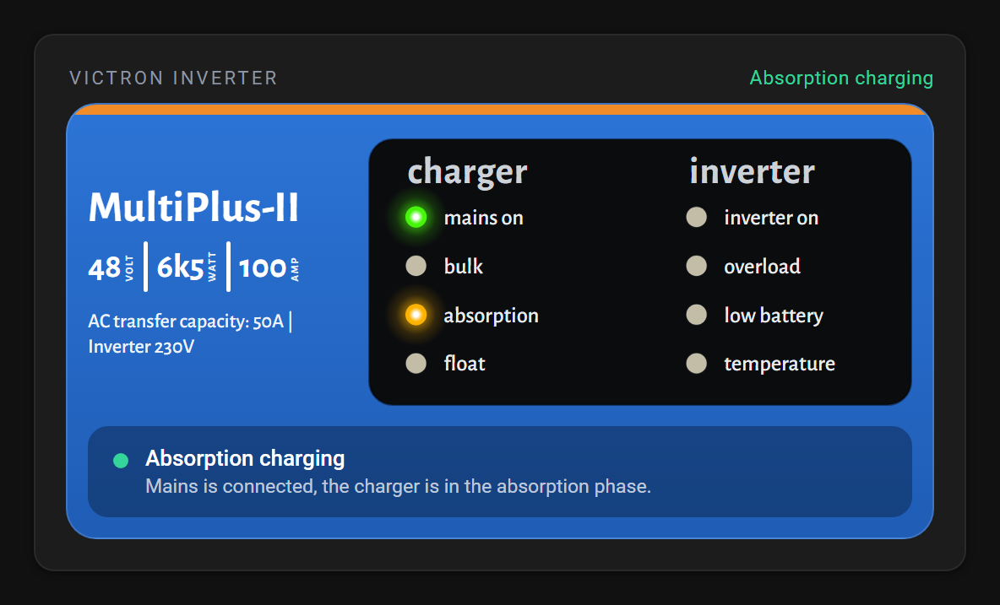<br><sub><b>Absorption charging</b></sub></td>
<td align="center">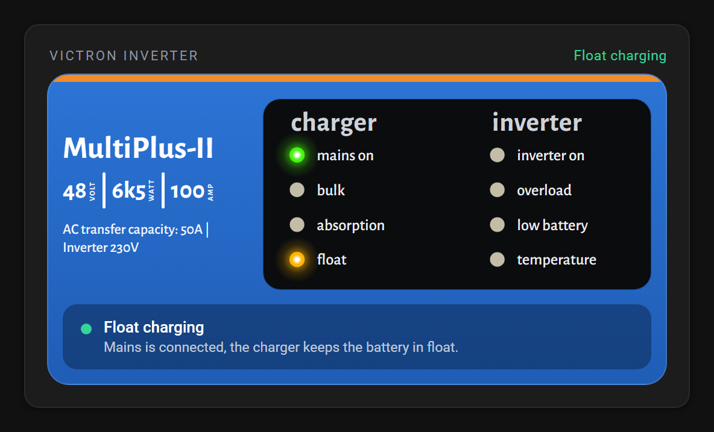<br><sub><b>Float charging</b></sub></td>
</tr>
<tr>
<td align="center">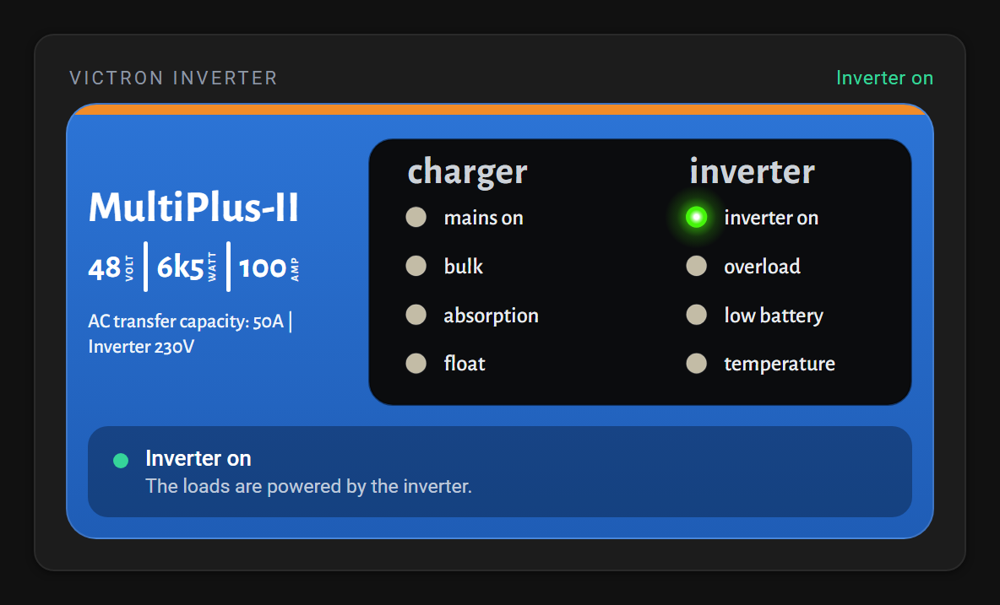<br><sub><b>Running on the battery</b></sub></td>
<td align="center">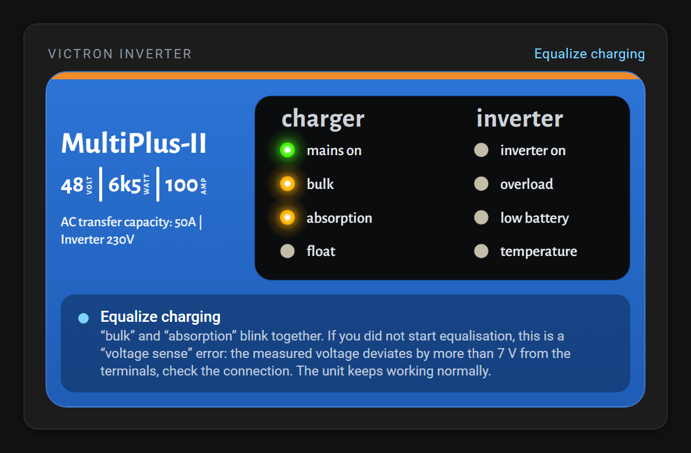<br><sub><b>Equalize (bulk and absorption blink together)</b></sub></td>
</tr>
<tr>
<td align="center">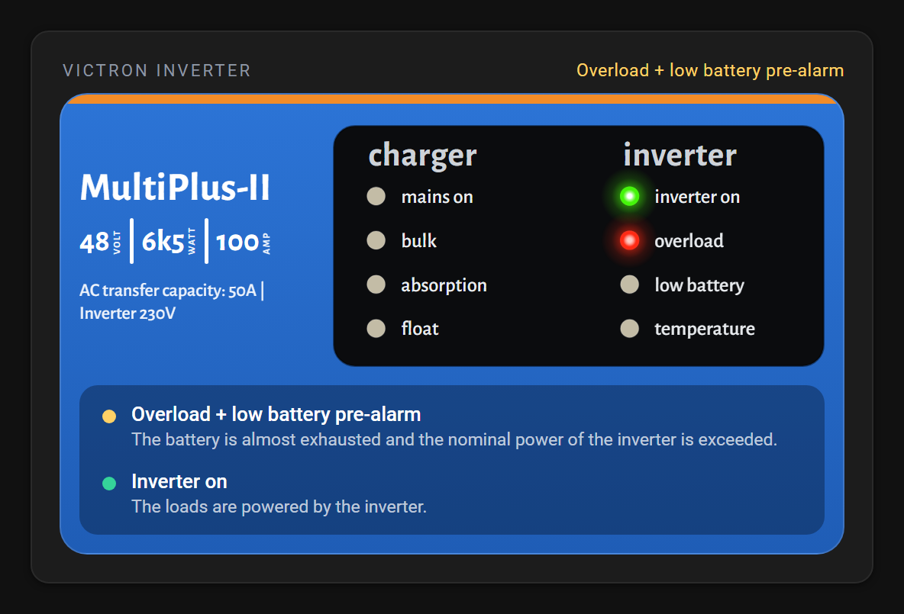<br><sub><b>Overload and low battery warning</b></sub></td>
<td align="center">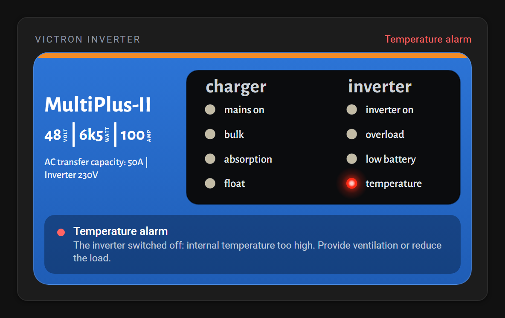<br><sub><b>Temperature alarm</b></sub></td>
</tr>
<tr>
<td align="center">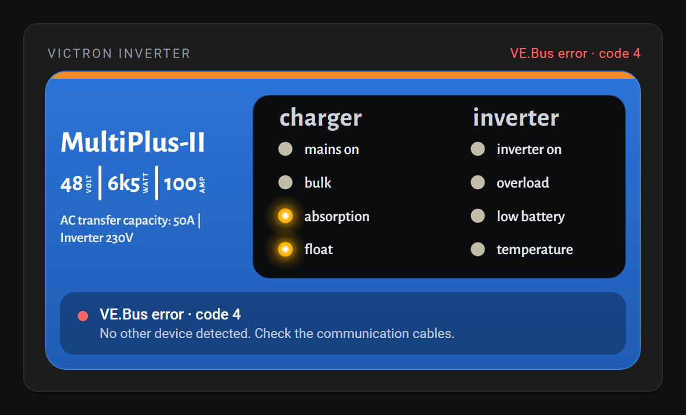<br><sub><b>VE.Bus error code 4</b></sub></td>
<td align="center">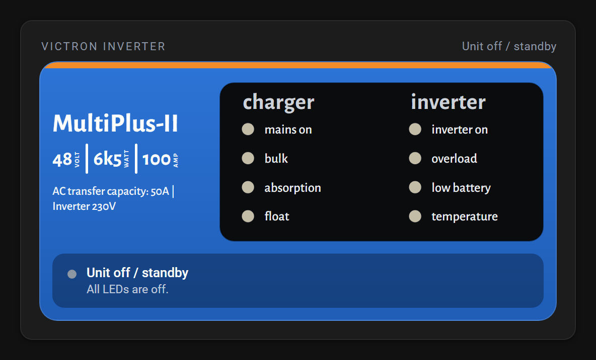<br><sub><b>Standby, all LEDs off</b></sub></td>
</tr>
<tr>
<td align="center" colspan="2">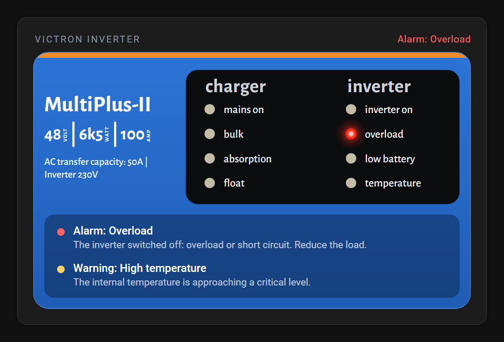<br><sub><b>Alarm sensors: an overload alarm and a high temperature warning</b></sub></td>
</tr>
<tr>
<td align="center">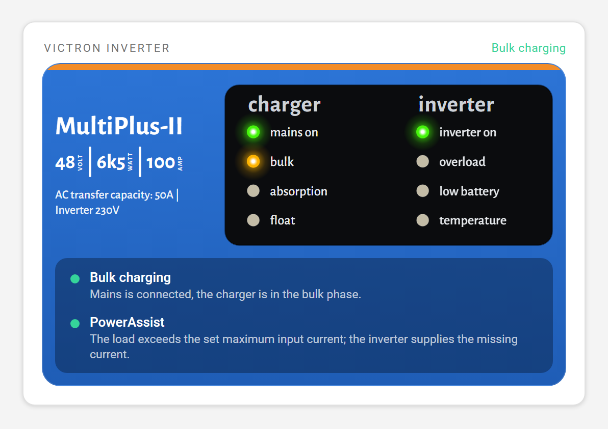<br><sub><b>Light theme</b></sub></td>
<td align="center"><br><sub><b>Set up for a 12/3000/120-32</b></sub></td>
</tr>
</table>

<div align="center">

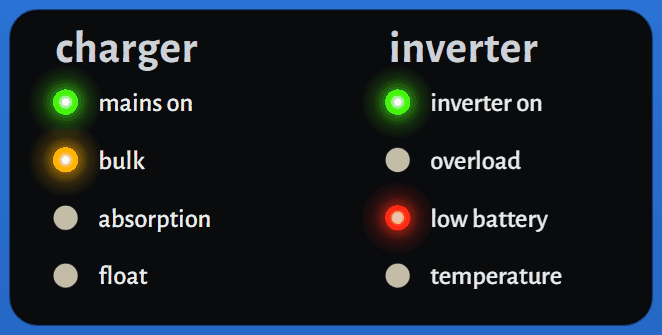

*Close-up: "inverter on" blinks while "overload" and "low battery" blink in the opposite phase.*

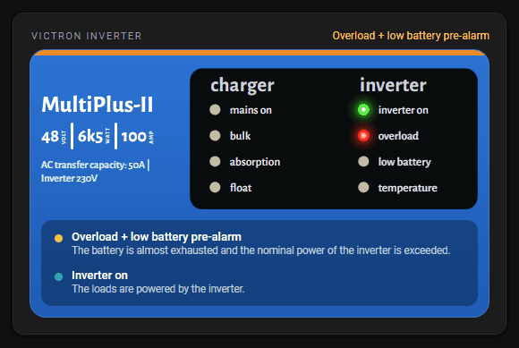

*The same state in English and in Romanian.*

</div>

## 📦 Installation

### HACS (custom repository)
1. In HACS open the ⋮ menu, choose **Custom repositories**, add `https://github.com/valimaties/victron-multiplus-II-card` and pick the category **Dashboard**.
2. Install **Victron MultiPlus-II Card** and reload the browser (Ctrl+F5).

### Manual
1. Copy `victron-multiplus-card.js` from the [latest release](https://github.com/valimaties/victron-multiplus-II-card/releases) to `/config/www/community/victron-multiplus-card/`.
2. Go to **Settings → Dashboards → ⋮ → Resources → Add**, enter `/local/community/victron-multiplus-card/victron-multiplus-card.js` and set the type to *JavaScript module*. Reload with Ctrl+F5.

## 🚀 Getting started

Add the card **Victron MultiPlus** from the list. The editor has a **Detect entities** button that looks for your sensors by name. If you prefer YAML:

```yaml
type: custom:victron-multiplus-card
inverter_type: 48/6k5/100-50      # the type code of your unit
entities:                         # the ids of your own sensors
  led_mains_on: sensor.multiplus_ii_mains_led
  led_bulk: sensor.multiplus_ii_bulk_led
  led_absorption: sensor.multiplus_ii_absorption_led
  led_float: sensor.multiplus_ii_float_led
  led_inverter_on: sensor.multiplus_ii_inverter_led
  led_overload: sensor.multiplus_ii_overload_led
  led_low_battery: sensor.multiplus_ii_low_battery_led
  led_temperature: sensor.multiplus_ii_temperature_led
  alarm_overload: sensor.multiplus_ii_overload_alarm   # alarms are optional
```

## 💡 Only the LEDs

If you only want the black window with the LEDs, without the blue panel and the text, set `layout: leds`. The card then has no background of its own, so it is just the window. Hover over it to see the status as a tooltip, and click a LED to open its sensor.

<div align="center">

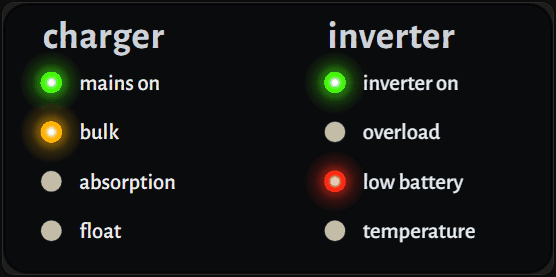

</div>

```yaml
type: custom:victron-multiplus-card
layout: leds
entities:
  led_mains_on: sensor.multiplus_ii_mains_led
  # ... the other LEDs, like above
```

The same setting is in the editor, in the **Layout** list.

## 🔌 Sensors

The card needs one sensor for each LED. The state can be text (`off`, `on`, `blinking`, `blinking_inverted`) or a number (`0` off, `1` on, `2` blinking, `3` blinking in the opposite phase).

Install [Victron MQTT](https://github.com/tomer-w/ha-victron-mqtt) version 2026.11.4 or newer. For the VE.Bus device it creates:

- 8 LED sensors: *Mains LED, Bulk LED, Absorption LED, Float LED, Inverter LED, Overload LED, Low battery LED, Temperature LED*. Their states are `off`, `on`, `blinking`, `blinking_inverted`.
- 10 alarm sensors: *Grid lost, High DC current, High DC voltage, High temperature, Low battery, Overload, Phase rotation, Ripple, Temperature sensor, Voltage sensor*. Their states are `no_alarm`, `warning`, `alarm`.

Pick them in the editor, or write them in YAML like above. The entity ids depend on the name of your device.

An alarm sensor that reports a warning or an alarm replaces the text the card would work out from the LEDs for the same thing, and it adds the alarms that have no LED (grid lost, high DC voltage or current, phase rotation, voltage and temperature sensor). If the sensor says `no_alarm` but a LED shows an alarm, the LED still counts.

Older versions of the integration made the LEDs plain on/off binary sensors, so a blinking LED looked the same as a lit one. If that is what you have, update it.

## 🧭 What the LEDs mean

<div align="center">

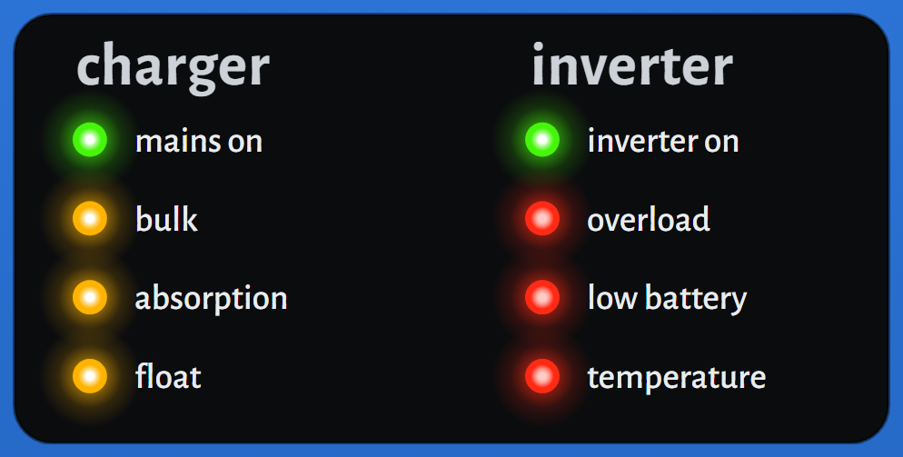

*Green: mains on, inverter on. Amber: bulk, absorption, float. Red: overload, low battery, temperature.*

</div>

| On the unit | The card says |
|---|---|
| mains on + **bulk** | Bulk charging |
| mains on + **absorption** | Absorption charging |
| mains on + **float** | Float charging |
| **bulk + absorption** | BatterySafe |
| bulk and absorption **blinking together** | Equalize (or a *voltage sense* error if you did not start equalisation) |
| **inverter on** | Inverter on, the loads run from the inverter |
| inverter **blinking** + mains on | PowerAssist |
| mains **blinking** | PowerControl, or the mains is being rejected or synchronised |
| bulk **blinking** + mains on | Bulk protection (the 10 h bulk limit was exceeded) |
| overload **blinking** or **on** | Overload warning or alarm |
| low battery **blinking** or **on** | Low battery warning or alarm |
| overload and low battery blinking **one after the other** | Overload and low battery warning |
| overload and low battery blinking **together**, or both **on** | Ripple warning or alarm |
| temperature **blinking** or **on** | Temperature warning or alarm |
| absorption and float blinking together | Battery temperature sensor looks wrong |
| inverter blinking **in the opposite phase** to bulk, absorption or float | **VE.Bus error**, code `9·bulk + 3·absorption + float`, counting each LED as 0 off, 1 flashing, 2 on |

This follows chapters 3.4, 6.2 and 6.3 of the MultiPlus-II manual.

## ⚙️ Options

| Option | Default | What it does |
|---|---|---|
| `inverter_type` | `48/6k5/100-50` | The type code of the unit, `volt/watt/amp-AC transfer`. It sets the printed *48 volt \| 6k5 watt \| 100 amp* and *AC transfer capacity*. You can leave out the AC transfer part. |
| `inverter_model` | `MultiPlus-II` | The model name printed on the panel. |
| `ac_voltage` | `230` | Printed as *Inverter 230V*. |
| `inverter_specs`, `inverter_note` | | Free text instead of the specs line and the note line. |
| `layout` | `full` | `full` for the whole panel, `leds` for only the black LED window. |
| `title` | | Optional text above the panel. There is none by default. |
| `language` | `auto` | `auto` follows Home Assistant, or set `en` or `ro`. |
| `led_blink` | `0.65` | How many seconds one blink phase lasts (on, or off). |
| `entities.led_*` | | One sensor per LED: `led_mains_on`, `led_bulk`, `led_absorption`, `led_float`, `led_inverter_on`, `led_overload`, `led_low_battery`, `led_temperature`. |
| `entities.alarm_*` | | Alarm sensors, optional: `alarm_grid_lost`, `alarm_high_dc_current`, `alarm_high_dc_voltage`, `alarm_high_temperature`, `alarm_low_battery`, `alarm_overload`, `alarm_phase_rotation`, `alarm_ripple`, `alarm_temperature_sensor`, `alarm_voltage_sensor`. |

The words printed on the unit (*charger, mains on, volt, watt, amp, AC transfer capacity*...) stay in English, as they are on the real panel.

## 🌍 Languages

The card uses the language of your Home Assistant profile, or the one you set with `language:`. Everything that is not printed on the unit gets translated: the title, the status lines, the VE.Bus codes and the editor.

English and Romanian are there for now. To add another one, copy the `en` block of the `I18N` table at the top of `victron-multiplus-card.js`, translate the values and send a pull request.

## 🛠️ Problems

- **Everything is dim and it says "No data".** The sensors are missing or unavailable. Check the entity ids in the editor.
- **The sensors say `unknown` after a restart.** The GX only sends a value when it changes. Reload the Victron MQTT integration or wait for the next change.
- **A blinking LED looks lit all the time.** Your Victron MQTT integration is an older version with on/off binary sensors. Update it.
- **The card did not change after an update.** Add `?v=2` to the resource URL and reload hard. The console shows which version was loaded.

## ⚠️ Compatibility

Made for the MultiPlus-II. The type code only changes the printed text, so other models with the same front work too. The Quattro, the Inverter Control panel and other products have a different front and are not supported.

## 🙏 Credits and disclaimer

- The decoding follows the Victron MultiPlus-II manual.
- The sensors come from the [Victron MQTT](https://github.com/tomer-w/ha-victron-mqtt) integration by [tomer-w](https://github.com/tomer-w).
- The font is [Alegreya Sans](https://github.com/huertatipografica/Alegreya-Sans) by Juan Pablo del Peral, under the SIL Open Font License 1.1 ([AlegreyaSans-OFL.txt](AlegreyaSans-OFL.txt)). A small part of it is embedded in the card.
- This is a personal project. It has no connection to Victron Energy B.V., which neither supports nor endorses it. *Victron Energy* and *MultiPlus* are trademarks of their owner. The card only imitates the look of the unit to show its state.

## 📄 License

[MIT](LICENSE)
